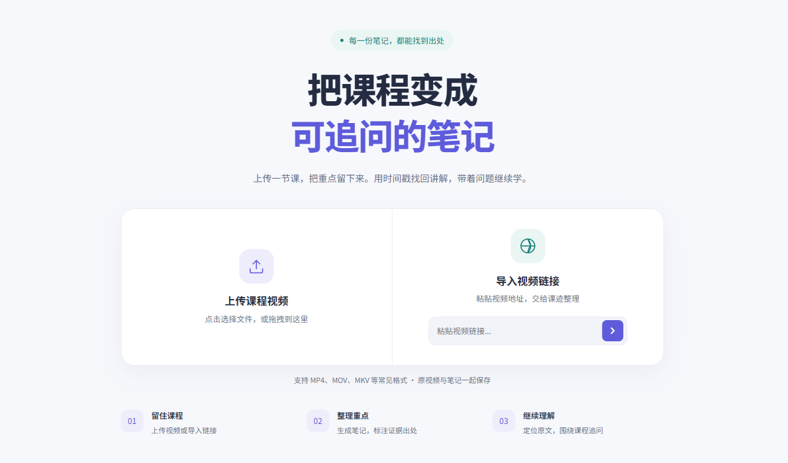

# 课迹 Agent · CourseTrace

把课程视频变成可追问、可查出处的学习笔记。支持本地视频与公开视频链接接入、目标驱动分析、知识点和自测题生成、七天行动计划、时间戳证据定位及多轮问答。

## 能做什么

| 能力 | 当前实现 |
|---|---|
| 视频接入 | 5MiB分片上传、查询缺失块、流式合并；通过yt-dlp接入支持的公开视频链接 |
| 音画材料 | FFmpeg切音频与选帧；ASR和本机Tesseract OCR并行，按时间窗融合文字 |
| 目标分析 | Planner拆任务、Executor生成产物、Critic检查，Java补充结构与原文校验 |
| 证据定位 | 模型选择原文编号，程序回填原句、来源和时间窗；点击时间戳播放对应片段 |
| 长视频选材 | 分层摘要、关键词／OCR／Embedding混合检索；预算条件内完整总结保留全片材料 |
| 持续问答 | Function Calling检索当前视频，事实与应用建议分开，仅将合格回答存入记忆与缓存 |
| 可靠执行 | RocketMQ异步调度、Redisson锁、阶段Checkpoint、两级限流、有限重试与执行预算 |
| 工作台 | 默认浅色、主题切换、桌面及窄屏布局、SSE进度、真实阶段记录与结果复用标记 |

## 技术栈

| 层 | 技术与职责 |
|---|---|
| 前端 | Vue 3、Vite：上传、目标选择、报告、播放器和证据交互 |
| 服务 | Java 21、Spring Boot、MyBatis-Plus、Flyway：接口、业务编排、持久化与迁移 |
| Agent | LangChain4j、Planner–Executor–Critic、Function Calling：模型消息、工具请求与受控分析 |
| 材料与检索 | FFmpeg、ASR、Tesseract OCR、Embedding：时间轴材料与多路检索；Qdrant可选 |
| 任务与存储 | RocketMQ、Redis、Redisson、MySQL兼容数据库、MinIO |

主分析模型接收的是ASR／OCR文字、时间和截图地址等文本信息；当前实现不把MP4或截图像素发送给主分析LLM，也不将无文字画面的理解视为已经实现。

## 完整处理流程

~~~mermaid
sequenceDiagram
    autonumber
    participant Web as Vue 工作台
    participant API as Spring Boot
    participant MQ as RocketMQ
    participant Worker as 消费者
    participant Agent as AgentLoop
    participant State as 数据与存档

    Web->>API: 上传视频或提交链接
    API->>State: 保存媒体、识别重复内容
    API-->>Web: 返回视频编号
    Web->>API: 提交目标与模式
    API->>State: 查已有报告
    alt 报告已存在
        State-->>API: 已存结果
        API-->>Web: 200：复用报告与真实记录
    else 需要新分析
        API->>API: 归属校验、占位、限流
        API->>MQ: 投递任务
        API-->>Web: 202：已受理
        MQ->>Worker: 消费任务
        Worker->>State: 加锁、查结果与存档
        opt 素材未保存
            par 语音分支
                Worker->>Worker: 分段音频 → ASR
            and 画面分支
                Worker->>Worker: 选帧 → OCR
            end
            Worker->>State: 保存融合素材
        end
        Worker->>Agent: 素材、目标、模式
        Agent->>Agent: 选材 → 规划 → 生成 → 检查
        Agent->>State: 保存结果与质量状态
        Worker-->>API: 阶段事件
        API-->>Web: SSE：进度与最终状态
    end
~~~

已有报告与新任务走不同路径：`200`表示已存在结果，`202`表示后台任务受理。视频链接下载当前仍在上传接口里同步等待；完整AI分析才进入MQ。SSE由`TaskEventService`发送，后台各阶段记录真实事件并推送，事件丢失时仍可查询状态和已保存记录。

## Agent怎样检查与修正

~~~mermaid
flowchart TD
  A["按目标选证据"] --> P["生成或恢复计划"]
  P --> E["Executor 生成草稿"]
  E --> R["原文回填 · 保存草稿"]
  R --> C{"Critic + 程序检查"}
  C -->|"通过"| OUT["保存报告与质量状态"]
  C -->|"可继续修正"| FIX["按需补证 / 重规划"]
  FIX --> E
  C -->|"轮次用完"| OUT
~~~

模型负责理解目标、生成和评判；Java负责原文编号回填、结构与时间校验、阶段保存和终止条件。Planner优先恢复已存计划，常规轮次通过即结束；只有缺少要求才重规划，缺证据时定向补证。最多两轮由配置控制，预算异常会结束本次运行，达到轮次上限的结果可以带质量警告。

阶段存档支持复用已保存材料、计划或草稿，从未完成阶段继续处理。

## 追问与工具调用

~~~mermaid
flowchart TD
  Q["当前视频追问"] --> HIT{"合格答案缓存?"}
  HIT -->|"命中"| OUT["返回答案与出处"]
  HIT -->|"未命中"| TOOL["模型请求工具"]
  TOOL --> JAVA["Java 检索并回填"]
  JAVA --> AGENT["Agent 生成与检查"]
  AGENT --> SAVE["合格才写记忆与缓存"]
  SAVE --> OUT
~~~

工具检索是`AiService`的前置增强步骤，之后仍由受控Agent生成与核验局部回答。工具交互最多三轮，每轮可能请求多个工具。持久答案缓存仅复用符合启发式条件的独立问题；有指代或依赖历史的追问保守跳过缓存。缓存键按媒体、目标、模式和问题隔离，未通过检查的答案不写问答历史或合格答案缓存。

## 快速启动

### 环境

Java 21+、Node.js 22+、Maven（或仓库Maven Wrapper）、Docker Compose、FFmpeg、Tesseract（`chi_sim`与`eng`语言包）、yt-dlp。模型需要可用的LLM、ASR和Embedding接口。

复制仓库根目录的`.env.example`为`.env`，按实际环境填写模型Key、中间件凭据、地址和模型名。文件只保存在本地；`.env`、数据目录和用户视频不提交。变量名称`SILICONFLOW_API_KEY`、`SILICONFLOW_BASE_URL`是当前配置入口，亦可填写兼容模型服务，不限定供应商。

容器基础设施脚本在Bash环境执行：

~~~bash
cp .env.example .env
# 填写 .env 后启动基础设施；脚本不会启动前后端。
bash scripts/dev-up.sh
~~~

第二个终端，从仓库根目录启动后端：

~~~bash
set -a
source .env
set +a
cd backend
bash ./mvnw spring-boot:run
~~~

第三个终端启动前端：

~~~bash
cd web
npm ci
npm run dev -- --host 127.0.0.1 --port 5178 --strictPort
~~~

打开 [本地工作台](http://127.0.0.1:5178/)，后端默认`127.0.0.1:9090`。PowerShell用户可先把`.env`变量载入当前进程，再使用`backend/mvnw.cmd`；前端命令相同。Tesseract语言包需安装到自己的运行环境。

本机单人工作台没有登录／注册页面：需要在`.env`中开启`LOCAL_SESSION_ENABLED=true`，并让`LOCAL_SESSION_USER_ID`指向当前数据库已有的媒体用户。`POST /user/local-session`仅接受本机连接与本机Origin；它不负责创建新用户。空数据库可以通过现有`POST /user/register`接口创建用户，再按实际用户编号配置。默认关闭本机会话入口，公共部署需接入正常身份流程，媒体接口仍执行归属校验。

通用Compose支持MySQL兼容数据库、Redis、MinIO、RocketMQ及可选Qdrant；关闭Qdrant后可使用本地向量评分。

### 使用

1. 上传视频或粘贴受支持的视频链接，等待得到媒体记录。
2. 选择分析模式，输入当前视频的目标，再点击“开始分析”。更换视频时同步修改目标。
3. 查看报告、质量提示、原任务阶段记录；点击时间戳核对原视频。
4. 继续提问或搜索证据。新问题、新目标或新视频可能需要实际调用模型。

同用户相同文件在服务端合并后去重。已有同视频／目标／模式报告直接复用。勾选“展示处理过程”时，页面逐步呈现已保存的处理阶段，也可以直接查看报告。

公开视频链接接入由yt-dlp负责；登录、付费、地域和平台访问限制按视频来源处理。

## 目录

~~~text
backend/       Spring Boot、Agent、媒体、存档、检索与后端测试
web/           Vue 工作台与前端测试
docs/          技术说明、接口分析与界面资源
extension/     可选浏览器客户端
scripts/       基础设施启动脚本
rocketmq/      Broker 配置
.github/       CI 工作流
~~~

## 许可证

许可证与必要署名见 [LICENSE](LICENSE) 和 [NOTICE](NOTICE)。
